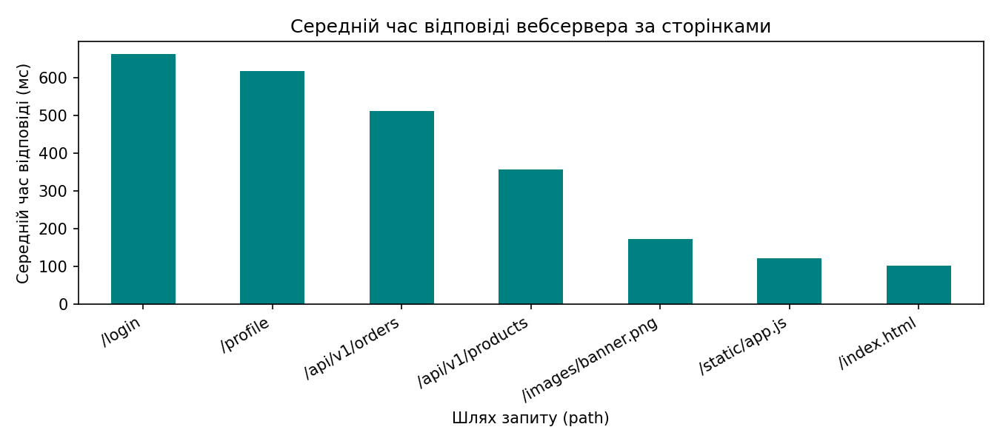

# Аналіз журналу запитів вебсервера 

## Опис проєкту
Навчальний аналіз журналу запитів вебсервера засобами Python (`pandas`, `matplotlib`) у межах лабораторної роботи №11 «Gemini Notebook, Google Colab і GitHub: AI та хмарне програмування».

## Структура репозиторію
- `notebooks/` — Jupyter Notebook із кодом завантаження даних, аналізу та побудови графіків (`lab_analysis.ipynb`)
- `data/` — навчальний синтетичний набір даних (`webserver_logs.csv`)
- `docs/` — збережені діаграми та супровідні матеріали (`chart.png`)

## Як запустити
1. Натисніть кнопку **Open in Colab** на початку цього файлу.
2. У меню Google Colab оберіть **Runtime → Run all**, щоб виконати всі комірки.

## Дані
Синтетичний навчальний набір даних містить **30 записів** про запити до вебсервера з **5 полями**:
- `path` — шлях запитуваної сторінки або ресурсу;
- `status_code` — HTTP-код відповіді сервера (200, 201, 400, 404, 500);
- `response_ms` — час відповіді сервера (у мілісекундах);
- `hour` — година доби, коли надійшов запит (0–23);
- `bytes` — обсяг переданих даних (у байтах).

## Результати

## Автор
Демків Олександр, група ПІ-25-01
